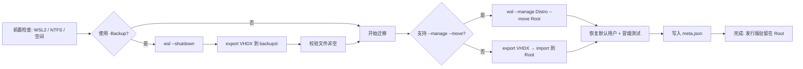
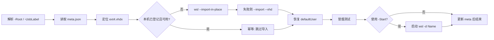
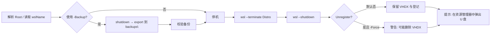

# WslUsb — WSL2 VHDX 便携工具

单个 PowerShell 脚本，把 WSL2 发行版的 **VHDX 迁到 U 盘（或任意目录）**，插上后导入使用，拔出前安全停机；迁移 / 卸载前可做冷备份。

> 运行环境：Windows PowerShell 5.1+（或 PowerShell 7+），已启用 **WSL2**。请在 **Windows** 侧执行本脚本（不要在 Linux shell 里跑）。  
> 若提示无法执行脚本：`Set-ExecutionPolicy -Scope CurrentUser RemoteSigned`，或：`powershell -ExecutionPolicy Bypass -File .\WslUsb.ps1 Help`

## 布局

```text
wsl-usb-kit/
  WslUsb.ps1          # 唯一脚本
  README.md

# 迁移后的驻留目录（U 盘或指定磁盘），由脚本生成：
<Root>/
  meta.json
  ext4.vhdx           # 或 --move/--import 产生的 vhdx
  backups/            # -Backup 输出
  logs/
```

## 命令一览

```powershell
cd path\to\wsl-usb-kit

# 1) 迁移到 U 盘/目录（迁移前备份）
.\WslUsb.ps1 Move -Distro Ubuntu -Root E:\WSL\Ubuntu -Backup -Confirm

# 2) 插入 U 盘后导入
.\WslUsb.ps1 Import -Root E:\WSL\Ubuntu -Start

# 3) 弹出前卸载/同步（卸载前备份）
.\WslUsb.ps1 Eject -Root E:\WSL\Ubuntu -Backup

# 辅助
.\WslUsb.ps1 Status -Root E:\WSL\Ubuntu
.\WslUsb.ps1 Backup -Distro Ubuntu -Root E:\WSL\Ubuntu
.\WslUsb.ps1 Help
```

也可按卷标定位 U 盘（相对路径默认 `WSL\Ubuntu`）：

```powershell
.\WslUsb.ps1 Import -UsbLabel WSLKIT
```

| 参数 | 说明 |
|------|------|
| `-Distro` | 源发行版名（Move / Backup） |
| `-Root` | 驻留目录 |
| `-UsbLabel` | 按卷标找盘 |
| `-Name` | 本机登记名（可与源名不同） |
| `-DefaultUser` | 默认 Linux 用户（写入 meta / 恢复登录） |
| `-Backup` | Move / Eject 前先冷备份 VHDX |
| `-BackupDir` | 备份目录，默认 `<Root>\backups` |
| `-Start` | Import 成功后进入发行版 |
| `-Unregister` | Eject 时尝试注销（默认关闭；需另加 `-Force`） |
| `-SkipHash` | 备份时跳过 SHA256 |
| `-Confirm` / `-WhatIf` | 确认 / 演练 |

退出码：`0` 成功 · `2` 前置失败 · `3` 备份失败 · `4` 迁移/导入失败 · `5` 用户取消。

---

## 主流程

### 1. Move — 安全迁移到 U 盘 / 指定目录



### 2. Import — 插入 U 盘后



### 3. Eject — 弹出 U 盘前



---

## 推荐日常用法

1. **首次**：`Move -Backup -Confirm` 迁到 U 盘。  
2. **换机 / 重新插入**：`Import -Start`。  
3. **带走前**：`Eject -Backup`，再在资源管理器里「弹出」。

## 安全要点

- 任何导出 / 迁移前脚本会 `wsl --shutdown`。  
- `-Backup` 失败则中止后续 Move / Eject。  
- **Eject 默认不 `unregister`**（官方 unregister 可能删掉虚拟盘文件）。  
- U 盘建议 **NTFS + USB3 固态移动盘**；普通闪存盘可用但很慢。  
- 建议对 U 盘开 BitLocker；归档含家目录与密钥。

## 能力探测与降级

| 能力 | 优先 | 降级 |
|------|------|------|
| Move | `wsl --manage --move` | `export --vhd` + `import` |
| Import | `import-in-place` | `import --vhd` |
| Backup | `export --vhd` | `export` 为 `.tar` |

若本机 WSL 较旧，先执行 `wsl --update`。
