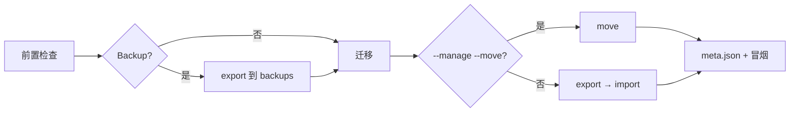
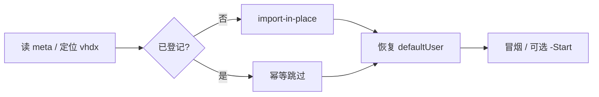
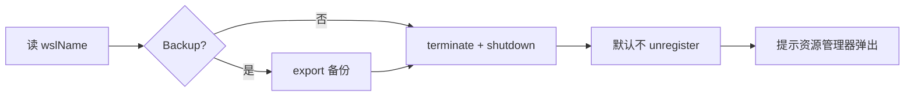

# Usb — VHDX 便携

将 WSL2 发行版以 **VHDX 驻留** 的方式放到 U 盘或任意目录：插上导入、拔前安全停机；迁移 / 卸载前可做冷备份。

入口：

```powershell
.\WslKit.ps1 Usb <Command> ...
# 或直接
.\kits\Usbkit.ps1 <Command> ...
```

---

## 用法示例

```powershell
cd path\to\wsl-usb-kit

.\WslKit.ps1 Usb Help

# 首次迁到 U 盘（迁移前备份）
.\WslKit.ps1 Usb Move -Distro Ubuntu -Root E:\WSL\Ubuntu -Backup -Confirm

# 换机 / 重新插入
.\WslKit.ps1 Usb Import -Root E:\WSL\Ubuntu -Start

# 带走前
.\WslKit.ps1 Usb Eject -Root E:\WSL\Ubuntu -Backup
# 然后在资源管理器中「弹出」U 盘

# 按卷标定位 U 盘（相对路径默认 WSL\Ubuntu）
.\WslKit.ps1 Usb Import -UsbLabel WSLKIT

# 辅助
.\WslKit.ps1 Usb Status -Root E:\WSL\Ubuntu
.\WslKit.ps1 Usb Backup -Distro Ubuntu -Root E:\WSL\Ubuntu
```

推荐日常：

1. **首次**：`Move -Backup -Confirm`
2. **换机 / 重新插入**：`Import -Start`
3. **带走前**：`Eject -Backup`，再在资源管理器里弹出

---

## 参数

| 参数 | 说明 |
|------|------|
| `-Distro` | 源发行版名（Move / Backup） |
| `-Root` | 驻留目录 |
| `-UsbLabel` | 按卷标找盘 |
| `-Name` | 本机登记名（可与源名不同） |
| `-DefaultUser` | 默认 Linux 用户 |
| `-Backup` | Move / Eject 前冷备份 |
| `-BackupDir` | 备份目录，默认 `<Root>\backups` |
| `-Start` | Import 成功后进入发行版 |
| `-Unregister` | Eject 时尝试注销（默认关；需另加 `-Force`） |
| `-SkipHash` | 备份时跳过 SHA256 |
| `-Confirm` / `-WhatIf` | 确认 / 演练 |

退出码：`0` 成功 · `2` 前置失败 · `3` 备份失败 · `4` 迁移/导入失败 · `5` 用户取消。

---

## 驻留目录布局

```text
<Root>/
  meta.json
  ext4.vhdx          # 或 --move/--import 产生的 vhdx
  backups/           # -Backup 输出
  logs/
```

---

## 主流程

### Move



1. **Move** — 迁移到目标目录（优先 `wsl --manage --move`，否则 export/import）
2. 可选 `-Backup`：迁移前先导出带时间戳的 VHDX/TAR 到 `backups\`

### Import



**Import** — 插入后登记（优先 `import-in-place`）。

### Eject



**Eject** — 拔出前停机/同步（默认 **不** `unregister`，避免误删 VHDX）。

---

## 安全要点

- 导出 / 迁移前会 `wsl --shutdown`。
- `-Backup` 失败则中止后续 Move / Eject。
- **Eject 默认不 unregister**（unregister 可能删除虚拟盘文件）。
- U 盘建议 **NTFS + USB3 固态移动盘**；建议 BitLocker。
- 从 GitHub ZIP 解压后若被 `RemoteSigned` 拦截：`Unblock-File .\WslKit.ps1`、`Unblock-File .\kits\*.ps1`。

---

## 能力探测与降级

| 能力 | 优先 | 降级 |
|------|------|------|
| Move | `wsl --manage --move` | `export --vhd` + `import` |
| Import | `import-in-place` | `import --vhd` |
| Backup | `export --vhd` | `export` 为 `.tar` |

WSL 较旧时先执行 `wsl --update`。
